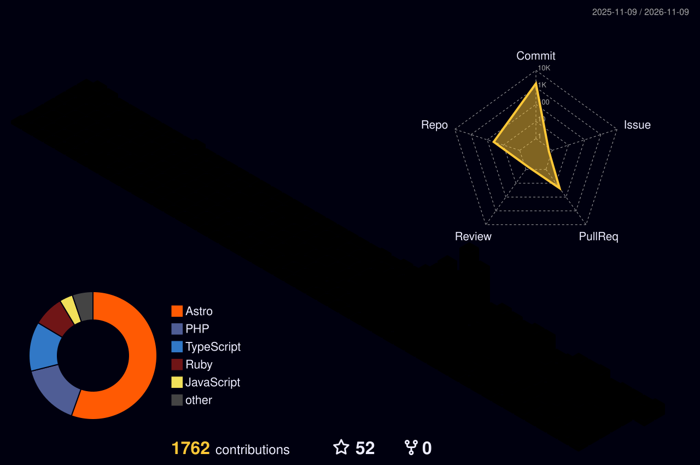

<!-- Generated by GitHub Profile Agent Console + Luminaria customization -->
<p align="center">
  <picture>
    <source media="(max-width: 760px) and (prefers-color-scheme: dark)" srcset="./assets/hero/agent-console-e199a9b3-mobile-dark.svg">
    <source media="(max-width: 760px)" srcset="./assets/hero/agent-console-e199a9b3-mobile-light.svg">
    <source media="(prefers-color-scheme: dark)" srcset="./assets/hero/agent-console-e199a9b3-dark.svg">
    <source media="(prefers-color-scheme: light)" srcset="./assets/hero/agent-console-e199a9b3-light.svg">
    
  </picture>
</p>

<p align="center">
  
</p>

<p align="center">
  
  
  
</p>

---

## 🎵 Now Playing

<p align="center">
  
</p>
<p align="center">
  
</p>
<p align="center">
  <a href="https://open.spotify.com/track/2GBgiuXwY1KzJMA0gSAr9J">
    
  </a>
</p>

---

## 💡 About Me

Aspiring software engineer dedicated to building practical, performant, and secure applications across modern web and mobile ecosystems.

Experienced in architecting cross-platform apps with **Flutter**, modern reactive interfaces with **Next.js & Vue**, robust backend APIs, and streamlining developer operations with **Docker & CI/CD pipelines**.

> 🕯️ **Why `luminaria`?**  
> Inspired by the Latin word *luminaria*, meaning "lights" or "sources of inspiration".  
> It also resembles **Nuari** phonetically: `luminari ≈ nuari`.  
> I want to build software that brings clarity, solves real problems, and creates value.

---

## 🚀 Current Focus

| Domain | What I am engineering & exploring |
| :--- | :--- |
| 📱 **Mobile Engineering** | **Flutter & Dart** — Cross-platform mobile development with Clean Architecture, state management (Provider/Bloc), local persistence (SQLite/sqflite), and responsive layouts. |
| 🌐 **Fullstack Web Systems** | **Next.js (App Router), Vue 3 & TypeScript** — High-performance reactive applications, server-rendered architectures, and scalable RESTful/FastAPI backend services. |
| 🛡️ **DevSecOps & CI/CD** | **Docker & GitHub Actions** — Automated test and deployment pipelines, containerized micro-environments, and cloud hosting workflows on Vercel. |
| 🔒 **AppSec & Network Core** | **Secure API Design, Auth/RBAC & OWASP Standards** — Implementing end-to-end encryption principles, tokenized authentication (JWT/OAuth2), and resilient network communication. |

---

## 🛠️ Tech Stack

<p align="center">
  
</p>

---

## 🔥 Featured Projects

| Project | Category / Stack | Highlights & Architecture |
| :--- | :--- | :--- |
| [**SOCA (Ocular Condition Analyzer)**](https://github.com/luminariadev/soca) | Fullstack AI Screening<br>`Vue 3` `Vite` `Tailwind` `PyTorch` | Clinical anterior eye screening platform backed by a PyTorch MobileNetV2 deep learning classifier achieving **97.99% validation accuracy**. |
| [**Gawean (Gamify Todolist)**](https://github.com/luminariadev/gawean-gamify-todolist) | Mobile Development<br>`Flutter` `Dart` `Provider` `SQLite` | Gamified productivity and task management mobile app with offline-first local SQL persistence, FL Chart analytics, and dynamic achievement systems. |
| [**Sabit Academy**](https://github.com/luminariadev/sabit-academy) | Modern Web Architecture<br>`Next.js 16` `React 19` `Tailwind v4` | High-performance educational web application leveraging modern Next.js App Router, modular components, and dark-mode glassmorphic layouts. [Live Demo ↗](https://sabit-jade.vercel.app/) |
| [**Aviatec Portal**](https://github.com/luminariadev/aviatec-portal) | Enterprise Web Platform<br>`Vue 3` `Tailwind CSS` `Vite` | Precision industrial instrument calibration and asset management portal with ISO-standard traceable documentation workflows. [Live Demo ↗](https://aviatec-artha.vercel.app/) |
| [**Evenstar**](https://github.com/luminariadev/evenstar) | Interactive Motion UI<br>`React 19` `GSAP` `Tailwind CSS` | High-aesthetic luxury product showcase featuring scroll-triggered GSAP animations, fluid transitions, and mobile-first responsive architecture. [Live Demo ↗](https://arwen-evenstar.vercel.app/) |
| [**Lumeria Bakery**](https://github.com/luminariadev/lumeria) | Modern E-Commerce<br>`React 19` `Vite` `Tailwind CSS` | Artisanal bakery showcase featuring custom hamper order builder and interactive WhatsApp checkout. [Live Demo ↗](https://lumeria-mu.vercel.app/) |
| [**VolunteerHub**](https://github.com/luminariadev/volunteer-hub) | Mobile Application<br>`Flutter` `Dart` `Laravel` `MySQL` | Cross-platform event & community volunteering app with RBAC and REST API, published on Google Play. |
| [**Greentify**](https://github.com/luminariadev/greentify) | Fullstack Community Platform<br>`Laravel 11` `Tailwind` `MySQL` `PWA` | Sustainable living editorial platform and community portal with role-based moderation and offline PWA caching. |

---

## 📊 Analytics & Activity

<p align="center">
  
  
</p>

<p align="center">
  
</p>

---

## 🌌 3D Contributions

<p align="center">
  
</p>

---

## 📌 Development Philosophy

```txt
Think clearly.
Build gradually.
Understand deeply.
Commit consistently.
Improve continuously.
```

---

## 📫 Let's Connect

<p align="center">
  <a href="mailto:rizkianuari83@gmail.com">
    
  </a>
  <a href="https://www.linkedin.com/in/rizkia-nuari-42b9b13a0/">
    
  </a>
  <a href="https://github.com/luminariadev">
    
  </a>
</p>

---

<p align="center">
  
</p>
